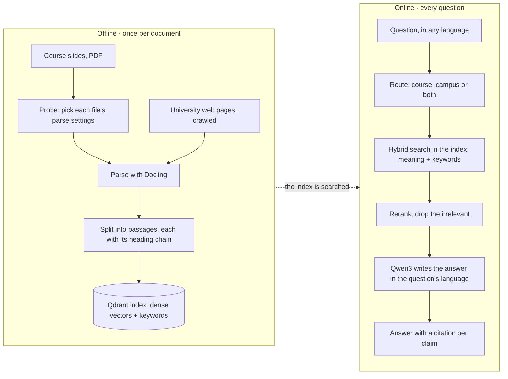

# UniGuide AI

Ask about a university course or about the campus in any language, and the answer comes back in that language, each claim citing the slide or web page it was drawn from, even when that source is written in another language. Multilingual retrieval-augmented generation over open-weights models (the Qwen family), with a website in front: a bachelor's thesis at the University of Florence.


## What it does

- **Answers across languages.** The question and the material need not share a language: an English question over the university's Italian pages, an Italian one over English slides. The answer follows the language of the question; the interface speaks Italian, English and Simplified Chinese.
- **Every claim cites its source.** A pill after each sentence names the web page or the slide it came from and opens it at the quoted passage or page.
- **Two kinds of material.** The course: lecture slides and notes in PDF. The campus: a crawl of the University of Florence's websites.
- **Open-weights models only.** Qwen3 models embed, rerank and write; no proprietary API is called, and the development setup runs on one 8 GB laptop GPU.
- ⛔ Generating or grading exercises is out of scope: it answers questions.

## How to use

**Without an account**, open the site and ask about the university: exams, Erasmus, fees, the School of Engineering's rules. The language menu at the top changes the interface; answers follow the question whatever the interface's language. Course material is for students with an account.

**Students** sign in, or register, to ask about their courses as well; their conversations stay in the sidebar.

**Staff** work from the *Management* group in the sidebar: a degree programme's teaching secretariat assigns teachers to course editions, a course's teachers add their colleagues to its current and later editions, and teachers and secretariat edit an edition's syllabus and reading list.

**Reading an answer:**

- the line above it says the search is complete and how long it took; opened, it lists where the search looked, how many excerpts it read and cited, and the languages of the question and of the sources;
- each claim ends with a pill naming its source;
- *Sources* lists the excerpts read, the cited ones first, each with a link to its page or slide;
- *Copy the answer* copies it.

## How it works

Retrieval-augmented generation is two pipelines that run at different times. **Offline**, once per document, the material is parsed, split into passages and indexed. **Online**, for every question, the passages closest to it are retrieved and a Qwen model writes the answer from them alone, citing each one it uses. A parse that garbles the text cannot be rescued later, and an answer is only as good as the passages retrieved for it: the model is the last step, not the first.



Docling parses; Qwen3-Embedding and BM25 index into Qdrant; Qwen3-Reranker reorders; a Qwen3 model behind any OpenAI-compatible server writes. Django serves the API and the React interface.

## Run it locally

With Docker, uv and Node.js installed, in PowerShell or any POSIX shell:

```shell
git clone https://github.com/Zhengjunliang/multilingual-course-assistant.git
cd multilingual-course-assistant
uv sync
npm ci --prefix frontend
npm run build --prefix frontend
cp .env.example .env               # set DJANGO_SECRET_KEY (the file has the command) and a DJANGO_DB_PASSWORD of your choice
docker compose up -d --wait        # PostgreSQL, Qdrant and Redis, healthy
uv run python manage.py migrate
uv run python manage.py createsuperuser
uv run python manage.py runserver  # http://127.0.0.1:8000/
```

The site answers once it has an index, a model and a worker, which answers the questions and ingests uploaded material: `uv run celery -A config worker -P solo -Q default,qa,ingest -l info`, in a second terminal. Course PDFs are not part of the repository, so you index your own, and generation calls any OpenAI-compatible server, a local Ollama by default: both steps, and the development loop, are in [docs/development.md](docs/development.md).

## Thesis

Bachelor's thesis in Information Engineering at the University of Florence, by Junliang Zheng, supervised by Prof. Marco Bertini. The design, the decisions and the measurements are in [docs/](docs/). MIT licence.
