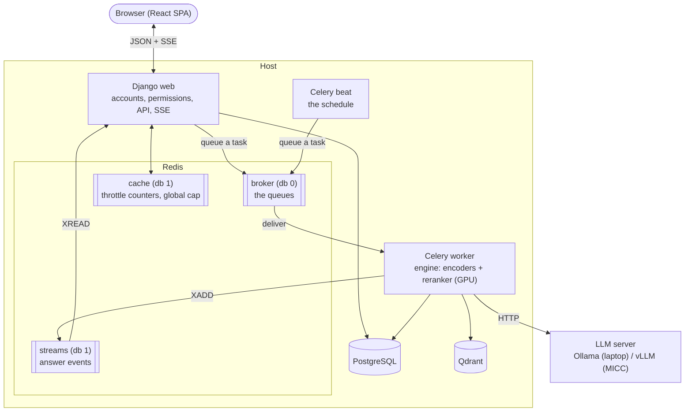

# Background tasks

This file owns what runs beside the web process: Redis and what each of its databases holds, the Celery worker with its queues, pools and time limits, beat and its schedule, and which work of the project goes to a worker. The values themselves are the sections "Cache" and "Background tasks" of [config/settings.py](../config/settings.py), each with its reason beside it; the commands that start the worker and beat are in [development.md](development.md), section "Daily loop".

- ✅ Redis is a compose service (`docker-compose.yml`) and holds the throttle counters (`config/settings.py`, section "Cache"). A worker runs the tasks queued on `default` (`config/celery.py`), and beat queues the nightly purge of expired sessions (`apps/accounts/tasks.py`).
- 🔜 M5 #230: questions answered on a worker, their events carried by a Redis stream that a reload resumes, a stop endpoint and a global cap on the questions waiting.

## Topology

The diagram is the topology #230 completes. ✅ The broker, the cache, the worker and beat run (`config/celery.py`). 🔜 M5 #230 adds the answer streams and moves the engine, the encoders and the reranker on the GPU, from the web process into the worker. Django and the worker run on the host under `uv run`, so that they reach the GPU; the comment at the top of `docker-compose.yml` says why, and #41 (M6) containerises them.

## Redis

One server, `redis:8` in `docker-compose.yml`, listening on the host's loopback only: it has no password, and the image turns Redis's protected mode off. Its snapshots go to the named volume `redis-data`, so a restart keeps the queued tasks. A password and the deployed server's persistence are #41's (M6). A rate-limited endpoint, asking or signing in, needs Redis to count: with Redis unreachable it answers `500` with the code `INTERNAL`, so the limits fail closed rather than letting requests through uncounted.

| Database | Holds | Named by |
| -------- | ----- | -------- |
| 0 | Celery's broker: one list per queue | `CELERY_BROKER_URL` |
| 1 | The site's own data: the throttle counters, through Django's cache; with #230 the global cap and the answer streams | `REDIS_URL` |
| 2, and 3 + N | pytest's: one for a run without pytest-xdist, one for each worker `gwN` | `tests/conftest.py` |

The broker and the site's data are kept in two databases because `cache.clear()` empties the whole database it is pointed at (`FLUSHDB`), and in the broker's it would drop every queued task. The tests get databases of their own for the same reason, and because every test worker numbers its users from 1, which would put two workers' throttle counters in one bucket.

## Queues, pools and time limits

**Queues are named by the work they hold.** Short tasks go to `default`; a long kind of work gets a queue and a worker of its own, so it never waits behind another kind: `qa` is #230's. Dify splits its queues the same way (dataset, mail, workflow runs and others, in its `api/docker/entrypoint.sh`, outside the repository).

**Acknowledged late, fetched one at a time.** A worker acknowledges a task once it is done, and takes one task at a time, so it never holds a second while another worker is free (Celery's Optimizing guide, outside the repository). A task whose worker goes down with it, the machine or the worker's main process, is then delivered again once the visibility timeout passes (below); a pool process killed under a task is acknowledged all the same, since requeuing it (`task_reject_on_worker_lost`, left off) would run a task that kills its process again and again. The price is that every task must be safe to run twice: the session purge is, since a second run finds nothing to delete.

**Pools.** Celery has not supported Windows since version 4 (its FAQ, outside the repository), and its default pool, prefork, does not work reliably there: the development worker uses `solo`, one task at a time in the worker's own process. On Linux, `default` keeps prefork; 🔜 M5 #230 runs `qa` on the threads pool, so that the threads share one copy of the models while each waits on the LLM server, with its concurrency read from the environment.

**Time limits.** Every task has a soft limit of 5 minutes, which raises inside the task so it can clean up, and a hard one of 6, which kills it. Only the prefork pool enforces them (Celery's Workers guide, outside the repository): `solo` and `threads` ignore them, so a task that runs on those pools bounds its own time, as #230's `qa` task must. Both limits stay far under the broker's visibility timeout, one hour on Redis: a task unacknowledged past it is delivered to a second worker while the first runs it.

## Beat

Beat is one process that queues each scheduled task when it falls due; it runs no task itself. Exactly one runs, since two would queue every task twice. The schedule is `CELERY_BEAT_SCHEDULE` in `config/settings.py`, in code rather than in a database (no django-celery-beat), so what runs and when changes with a commit, never from the admin. Its hours are Rome's (`CELERY_TIMEZONE`). Beat keeps the time of each task's last run in `celerybeat-schedule` in the directory it starts in, which git ignores.

| Task | When | Why |
| ---- | ---- | --- |
| `apps.accounts.tasks.clear_expired_sessions` | 04:00 every night | Django keeps an expired session's row until something deletes it, and asks for `clearsessions` to be run regularly |

## What goes to a worker

| Work | Where it runs | Status |
| ---- | ------------- | ------ |
| Throttle counters, shared by every process of the site | Redis, database 1 | ✅ `config/settings.py` |
| Purging expired sessions | beat, then a worker on `default` | ✅ `apps/accounts/tasks.py` |
| Answering a question | a worker on `qa` | 🔜 M5 #230 |
| Resuming an answer after a reload | a Redis stream per answer | 🔜 M5 #230 |
| Stopping an answer from the stop button | a stop endpoint, then the worker | 🔜 M5 #230 |
| A global cap on the questions waiting | an admission count in Redis | 🔜 M5 #230, with #12 |
| Ingesting uploaded course material | a worker | 🔜 M5 #35 |
| Bounding a document's parse time and pages | the ingest task | 🔜 M5 #36 |
| Snapshotting the Qdrant index | beat, then a worker on `default` | 🔜 M5 #122 |
| The deepening agent on the web (`rag/agent.py`) | a worker, over #230's streams | 🔜 M7, no issue |
| The load test | the whole stack on MICC | 🔜 M6 #41 |

## Why Celery

Celery with Redis is the supervisor's choice ([architecture.md](architecture.md), section "Chosen stack"). The alternative inside Django came with Django 6.0: `django.tasks` defines how a task is queued, but its built-in backends are for development and testing only and it ships no worker (Django 6.0 documentation, outside the repository), and this project is on 5.2 LTS. The same-kind RAG applications that run background work, Dify and Onyx, both run it on Celery with Redis (their source, outside the repository).
