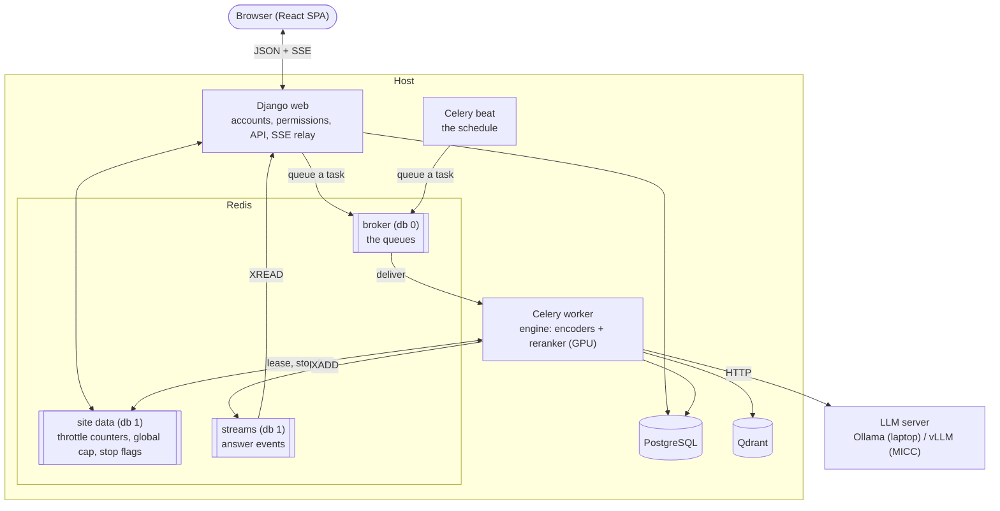
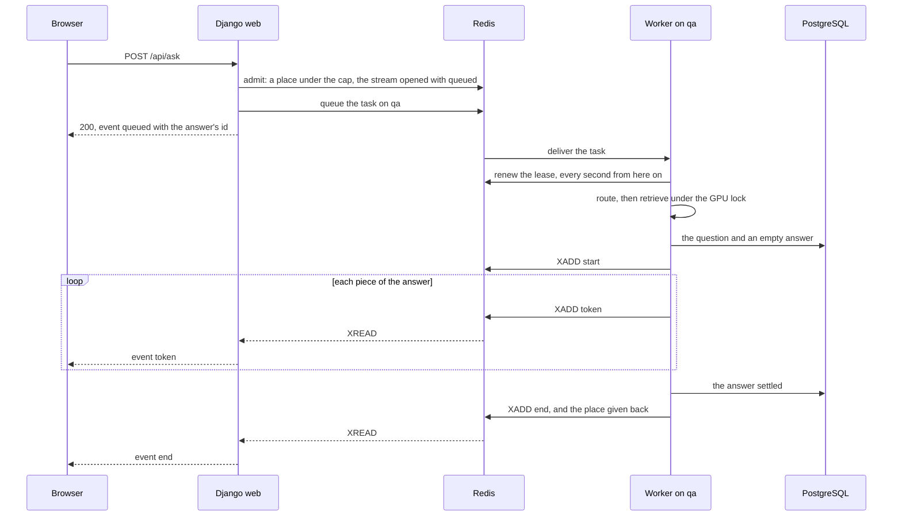

# Background tasks

This file owns what runs beside the web process: Redis and what each of its databases holds, the Celery worker with its queues, pools and time limits, beat and its schedule, how a question is answered on a worker, and which work of the project goes to one. The values themselves are the sections "Cache", "Question answering" and "Background tasks" of [config/settings.py](../config/settings.py), each with its reason beside it; the commands that start the worker and beat are in [development.md](development.md), section "Daily loop". The wire shape of an answer's events is [api.md](api.md), section "Question-answering API".

- ✅ Redis is a compose service (`docker-compose.yml`) and holds the throttle counters (`config/settings.py`, section "Cache"). A worker runs the tasks queued on `default` (`config/celery.py`), and beat queues the nightly purge of expired sessions (`apps/accounts/tasks.py`).
- ✅ Questions are answered on a worker consuming `qa` (`apps/qa/tasks.py`), under a global cap counted in Redis, and their events travel through a Redis stream per answer, which a reload reads again and a stop endpoint ends (`apps/qa/inflight.py`, `apps/qa/views.py`).

## Topology

✅ The diagram is the topology `config/celery.py`, `apps/qa/tasks.py` and `apps/qa/inflight.py` run: the engine, with the encoders and the reranker on the GPU, lives in the worker, and the web process loads no model. Django and the worker run on the host under `uv run`, so that they reach the GPU; the comment at the top of `docker-compose.yml` says why, and #41 (M6) containerises them.

## Redis

One server, `redis:8` in `docker-compose.yml`, listening on the host's loopback only: it has no password, and the image turns Redis's protected mode off. Its snapshots go to the named volume `redis-data`, so a restart keeps the queued tasks. A password and the deployed server's persistence are #41's (M6). A rate-limited endpoint, asking or signing in, needs Redis to count: with Redis unreachable it answers `500` with the code `INTERNAL`, so the limits fail closed rather than letting requests through uncounted. A question needs it twice over, for the cap and for its stream: with Redis unreachable it is refused in the same way.

| Database | Holds | Named by |
| -------- | ----- | -------- |
| 0 | Celery's broker: one list per queue | `CELERY_BROKER_URL` |
| 1 | The site's own data: the throttle counters, through Django's cache; under `QA_KEY_PREFIX`, the answers in flight, their streams, their stop flags and the answer each conversation waits for (`apps/qa/inflight.py`) | `REDIS_URL` |
| 2, and 3 + N | pytest's: one for a run without pytest-xdist, one for each worker `gwN` | `tests/conftest.py` |

The broker and the site's data are kept in two databases because `cache.clear()` empties the whole database it is pointed at (`FLUSHDB`), and in the broker's it would drop every queued task. The tests get databases of their own for the same reason, and because every test worker numbers its users from 1, which would put two workers' throttle counters in one bucket.

## Queues, pools and time limits

**Queues are named by the work they hold.** Short tasks go to `default`; a long kind of work gets a queue and a worker of its own, so it never waits behind another kind: `qa` holds the questions. Dify splits its queues the same way (dataset, mail, workflow runs and others, in its `api/docker/entrypoint.sh`, outside the repository).

**Acknowledged late, fetched one at a time.** A worker acknowledges a task once it is done, and takes one task at a time, so it never holds a second while another worker is free (Celery's Optimizing guide, outside the repository). A task whose worker goes down with it, the machine or the worker's main process, is then delivered again once the visibility timeout passes (below); a pool process killed under a task is acknowledged all the same, since requeuing it (`task_reject_on_worker_lost`, left off) would run a task that kills its process again and again. The price is that every task must be safe to run twice: the session purge is, since a second run finds nothing to delete. The one exception is a question, acknowledged as it starts (section *A question on a worker*).

**Pools.** Celery has not supported Windows since version 4 (its FAQ, outside the repository), and its default pool, prefork, does not work reliably there: the development worker uses `solo`, one task at a time in the worker's own process, and consumes both queues. On Linux, `default` keeps prefork, and `qa` gets a worker of its own on the threads pool, so that its threads share one copy of the models while each waits on the LLM server: `celery -A config worker -Q qa -P threads --disable-prefetch`, its thread count read by Celery's command line from `CELERY_WORKER_CONCURRENCY`, which is the worker's environment and not the site's settings. Deploying both workers is 🔜 M6 #41, and so is the measurement that sets that count.

**Time limits.** Every task has a soft limit of 5 minutes, which raises inside the task so it can clean up, and a hard one of 6, which kills it. Only the prefork pool enforces them (Celery's Workers guide, outside the repository): `solo` and `threads` ignore them, so the question task, which runs on those pools, checks its own 5 minutes between two events (`TIME_LIMIT_SECONDS`, `apps/qa/tasks.py`). Both limits stay far under the broker's visibility timeout, one hour on Redis: a task unacknowledged past it is delivered to a second worker while the first runs it.

## A question on a worker

✅ `apps/qa/views.py` takes the question, `apps/qa/tasks.py` answers it, and `apps/qa/inflight.py` is the one module that touches what the two share in Redis. One id, made by the web process, names the answer everywhere: the Celery task, the answer's stream, its stop flag, its place under the cap and the stored answer's row.

- **The web process answers nothing.** It admits the question under the cap, queues it, and relays the stream as the worker writes it, each event under the id it has in the stream. The relay reads with a blocking `XREAD` of 10 s; a read that comes back empty sends a keepalive comment and asks Redis whether the writer holds its lease, and one that lost it, or a stream gone, ends the response with `ENGINE_DOWN`. The relay touches no database.
- **Retrieval takes turns; generation does not.** The encoders and the reranker share one GPU, so the threads of a worker retrieve one at a time, under a lock held for retrieval alone; generation runs outside it, and several answers are written at once while the model server batches them (`apps/qa/engine.py`).
- **The rows are the worker's.** It writes the question and an empty answer once `start` exists, and settles the answer before it writes the last event, so a reader who receives `end` and reopens the conversation at once finds the answer whole (`apps/qa/conversations.py`). A question that fails or is stopped before `start` leaves nothing behind.
- **A lease, on one clock.** A question admitted holds its place for 2 minutes while it waits for a worker; the worker, from a heartbeat thread, renews it to 30 s every second while it answers. A worker that dies gives its places back within half a minute, with nothing to clean up, and its readers are told `ENGINE_DOWN`. Every decision about a lease is a Lua script that reads Redis's own `TIME`, so the web host's clock and the worker's never have to agree.
- **Answered once.** The task is acknowledged as it starts (`acks_late=False`), against the late acknowledgement every other task has: a question whose worker died is not worth answering an hour later, when the broker would deliver it again, since its reader was told it failed long before. A worker that takes a question after its lease ran out drops it.

### The cap

`QA_MAX_IN_FLIGHT` bounds the questions waiting for a worker or being answered, every web process of the site together; its default, 4, and the reason for it are in `config/env.py`. The count is a sorted set in Redis, one member per answer, scored by the moment its lease ends. Admitting a question is one script: it drops the members whose lease ran out, counts the rest and, under the cap, adds the question and opens its stream. At the cap the view answers a `503` `UNAVAILABLE` with `Retry-After: 60` at once, and nothing is queued; the page asks again by itself, twice at most. The per-caller rates of `ask` stay beside it, so that one caller is not the whole cap (`config/settings.py`). Dify bounds its concurrent requests the same way, with a Redis hash of their start times whose entries past 10 minutes are dropped (`api/core/app/features/rate_limiting/rate_limit.py`, outside the repository).

### Resuming

A signed-in student's answer goes on when the page closes, and is stored when it ends. A page reloaded meanwhile reads the conversation's `answering`, the answer it waits for, and reads that answer's stream again from its start: `queued` carries the question, so a question that waits for a worker shows too. A connection that drops before a terminal event is resumed once with `Last-Event-ID`, the header the SSE standard names, from the event after the last one read (`frontend/src/features/chat/follow.ts`). A stream is kept 10 minutes after its last event, as OpenAI keeps an unstored background response about as long (its Background mode guide, outside the repository); past that, the stored rows are the answer. LibreChat's resumable streams are Redis streams too, kept past their end for a while (outside the repository). A visitor's answer is not resumable: it is stored nowhere, and stops when they leave.

### Stopping and leaving

The stop button calls `POST /api/answers/<id>/stop`, which sets the answer's stop flag for 10 minutes, as Dify's `generate_task_stopped` lives (outside the repository). The heartbeat finds it within a second, and the worker ends the answer with `stopped`, keeping what it wrote with `complete=false`; stopped before `start`, it writes nothing. Closing the connection stops a visitor's answer the same way, since nobody else will read it, while a signed-in student's goes on to its end; deleting a conversation stops the answer being written into it. The Vercel AI SDK draws the same line: in a resumable stream an abort only disconnects, and stopping is an endpoint of its own (outside the repository).

## Beat

Beat is one process that queues each scheduled task when it falls due; it runs no task itself. Exactly one runs, since two would queue every task twice. The schedule is `CELERY_BEAT_SCHEDULE` in `config/settings.py`, in code rather than in a database (no django-celery-beat), so what runs and when changes with a commit, never from the admin. Its hours are Rome's (`CELERY_TIMEZONE`). Beat keeps the time of each task's last run in `celerybeat-schedule` in the directory it starts in, which git ignores.

| Task | When | Why |
| ---- | ---- | --- |
| `apps.accounts.tasks.clear_expired_sessions` | 04:00 every night | Django keeps an expired session's row until something deletes it, and asks for `clearsessions` to be run regularly |

## What goes to a worker

| Work | Where it runs | Status |
| ---- | ------------- | ------ |
| Throttle counters, shared by every process of the site | Redis, database 1 | ✅ `config/settings.py` |
| Purging expired sessions | beat, then a worker on `default` | ✅ `apps/accounts/tasks.py` |
| Answering a question | a worker on `qa` | ✅ `apps/qa/tasks.py` |
| Resuming an answer after a reload | a Redis stream per answer | ✅ `apps/qa/inflight.py` |
| Stopping an answer from the stop button | a stop endpoint, then the worker | ✅ `apps/qa/views.py` |
| A global cap on the questions in flight | a sorted set of leases in Redis | ✅ `apps/qa/inflight.py` |
| Ingesting uploaded course material | a worker | 🔜 M5 #35 |
| Bounding a document's parse time and pages | the ingest task | 🔜 M5 #36 |
| Snapshotting the Qdrant index | beat, then a worker on `default` | 🔜 M5 #122 |
| The deepening agent on the web (`rag/agent.py`) | a worker, over the answer streams | 🔜 M7, no issue |
| The load test | the whole stack on MICC | 🔜 M6 #41 |

## Why Celery

Celery with Redis is the supervisor's choice ([architecture.md](architecture.md), section "Chosen stack"). The alternative inside Django came with Django 6.0: `django.tasks` defines how a task is queued, but its built-in backends are for development and testing only and it ships no worker (Django 6.0 documentation, outside the repository), and this project is on 5.2 LTS. The same-kind RAG applications that run background work, Dify and Onyx, both run it on Celery with Redis (their source, outside the repository). Why the questions themselves go to a worker is [decisions.md](decisions.md), 2026-10-29, *Questions are answered on a Celery worker, and the browser reads the answer from a Redis stream*.
