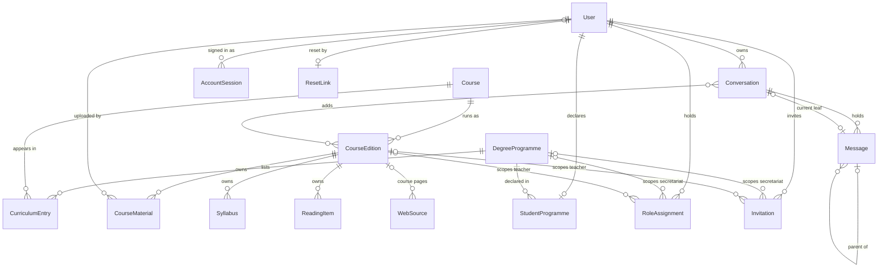

# Data model

## Purpose and owner

This file owns the website's relational schema: its entities and relationships, the scope invariants, the contract between `apps/` and `rag/`, and the concrete migration order. The decisions and their reasons are owned by [decisions.md](decisions.md), the two entries of 2026-09-25, the role scopes by [decisions.md](decisions.md), 2026-09-29, *Staff permissions are a registry in code, answered by one backend; the admin is the superuser's*, and the code and year formats and the rule that an AD code names one course by [decisions.md](decisions.md), 2026-09-28, *An AD code belongs to one course, and codes and years are written in ASCII*; the chunk field table by [docling-pipeline.md](docling-pipeline.md), section 3.6 (the chunk payload contract). Progress lives in GitHub issues: the epic `#94`, and `#35` `#36` `#93` for the parts they implement.

## Entities and relationships

✅ `User`, `StudentProgramme`, `AccountSession` and `ResetLink` exist in `apps/accounts/models.py`, `Conversation` and `Message` in `apps/qa/models.py`, `DegreeProgramme`, `Course`, `CourseEdition`, `CurriculumEntry`, `Syllabus` and `ReadingItem` in `apps/catalog/models.py`, `RoleAssignment` and `Invitation` in `apps/roles/models.py`, and `CourseMaterial` in `apps/materials/models.py`. 🔜 M5: every other entity below. `CourseEdition` is the centre: it owns the content, scopes a teacher, and is what a slides chunk's `course` and `academic_year` name. Rows with user-visible text carry `locale` — programme and course names, and `ReadingItem`, where it is the book's language; relation tables and `CourseMaterial` do not, since a file's language is recorded per chunk, and neither does `Syllabus`, whose sections are all in the edition's `syllabus_locale` ([decisions.md](decisions.md), 2026-09-25, *The data model is decided on paper before roles are built on it*, point 6). Of a conversation only `Conversation.pinned` is set by its owner; what its sidebar row shows besides, its title and that title's language, its last message's time and what its last answer drew on, is derived from its `Message` rows when the list is read, never stored ([api.md](api.md)). A conversation and a message are keyed by a random version 4 UUID; each `Message` names its `parent`, the message it follows, and each `Conversation` its `current_leaf`, the message its thread ends at, so a thread is the path from the first question to that leaf ([decisions.md](decisions.md), 2026-10-27, *A conversation and its messages are named by random UUIDs, and a thread is a chain of parents*). An `AccountSession` is Django's session row with its account and its device, the browser, the address, when it signed in and when it was last seen, as columns projected from the session's data, so that an account's sessions are listed and ended by one indexed query and go with the account when it is deleted; a visitor's session has no account ([apps/accounts/sessions.py](../apps/accounts/sessions.py); [decisions.md](decisions.md), 2026-10-27, *Signing in stays a server-side session, which lives by its account's tier*). A `ResetLink` is an account's one link to set its password: a newer link replaces it, using it or a change of the password deletes it, and its token is kept as a SHA-256 digest alone ([apps/accounts/links.py](../apps/accounts/links.py)). An `Invitation` names a role and a scope as a `RoleAssignment` does, under the same check constraint, for whoever accepts it; its token is kept the same way, using or revoking it deletes it, and it goes with whoever made it ([apps/roles/invitations.py](../apps/roles/invitations.py)).

## Scope invariants

🔶 Enforced by database constraints where a constraint can express them; the rest waits for M5. ✅ The catalogue keys of invariant 1, in `apps/catalog/models.py`, the rule of invariant 2, in `apps/catalog/editions.py`, the constraints of invariant 3, in `apps/roles/models.py`, and its boundary and default, in `apps/qa/scope.py`, and the `CourseMaterial` key, in `apps/materials/models.py`. 🔜 M5: the `WebSource` key.

1. **Keys and formats.** This is the single owner of the format rules below; a comment elsewhere, such as `edition_of()`'s, points here rather than repeating them. `DegreeProgramme.code` and `Course.code` are unique, and `Course.code` and `CurriculumEntry.ad_code` each match `^[A-Z0-9]+$`. A `CourseEdition` is unique per (`course`, `academic_year`), and `academic_year` matches `^[0-9]{4}-[0-9]{4}$`. A `CurriculumEntry` is unique per (`programme`, `curriculum`, `ad_code`) and per (`programme`, `curriculum`, `course`), with an empty string, never NULL, for "no curriculum", and its `year_of_study` is between 1 and 6. A `CourseEdition.period` is one of `TeachingPeriod`, the Cineca catalogue's semesters, or empty when not entered. A `Syllabus` row is unique per (`edition`, `section`), its `section` one of the seven of `SyllabusSection` and its text never empty, in Markdown; a `ReadingItem` is unique per (`edition`, `title`), its `importance` `required` or `recommended` and its `locale` a language tag Django knows. A `WebSource` is unique per (`url`, `edition`) with NULLs not distinct; a `CourseMaterial` per (`edition`, `sha256`), its `sha256` the file's digest in lowercase hex, its `source_file` never empty, its `status` one of `MaterialStatus` and its `failure` one of `MaterialFailure` exactly when the status is `failed`, empty otherwise. What the keys hold: `Course.code` is the AD code of the Moodle course that holds the material, fixed once entered, or, where no single Moodle course holds it, the AD code its curricula list, with `Course.code_source` set to `cineca-only` ([decisions.md](decisions.md), 2026-09-25, *PPM read from Moodle and Cineca*, point 6); any other AD code of the course is a `CurriculumEntry.ad_code`; when one curriculum lists two AD codes for a course, its entry takes the one listed only in that curriculum; an AD code belongs to one course, held by `Course.clean()` and `CurriculumEntry.clean()` rather than a database constraint ([decisions.md](decisions.md), 2026-09-28, *An AD code belongs to one course, and codes and years are written in ASCII*); `curriculum` is the name the Cineca catalogue prints, such as `TECNICO APPLICATIVO`; a `CourseMaterial`'s `source_file` is the name the uploaded file had and no key, so a file of that name and other bytes on the same edition is the material's next version, which replaces it once ready (`apps/materials/tasks.py`).
2. **One current edition per course, derived.** The current edition of a course is the newest one, by `academic_year`, whose teaching has started on the day asked: its `teaching_starts`, which falls within the academic year, 1 September to 31 August (`CourseEdition.clean()`), or 1 September of its first year when that is empty. Nothing stores it, so it cannot go stale, and years are unique per course, so two editions are never current together; a course with no edition started has none. An edition older than the current one, of whose course a later year has started, is past, and its teacher rows are not its course's teachers to change ([decisions.md](decisions.md), 2026-10-27, *A course's teachers staff its current and later editions, and leave each of them a teacher*); the current edition and those not started yet never are. The one definition of both is `with_current()` and `with_past()` in `apps/catalog/editions.py`, annotations that every reader of the catalogue and the role scopes go through ([decisions.md](decisions.md), 2026-09-25, *The data model is decided on paper before roles are built on it*, point 1).
3. **Role scopes, and what a caller reads.** A check constraint on `RoleAssignment`, and the same on `Invitation`: a teacher row has an `edition` and no `programme`, a secretariat row the reverse; its unique constraint treats NULLs as not distinct. The administrator is Django's `is_superuser` and has no row, and neither has a student ([decisions.md](decisions.md), 2026-09-29, *Staff permissions are a registry in code, answered by one backend*, point 2). An account declares at most one programme, and a year of study in it, in a `StudentProgramme` row; no row is no programme. Its **boundary**, what its search and `GET /api/sources` may read, is the started editions, current and past, of the courses its programme lists, and the editions `editions_for(user, Permission.EDITION_VIEW)` gives its roles; a superuser's is every edition. Its **default**, what a question searches unless its conversation adds more, is each course's current edition and the editions of a teacher's course that are not past. A conversation adds editions of the boundary (`Conversation.added_editions`); one the boundary no longer holds stays stored and is not searched. The programme is declared by the person, so it keeps a search consistent and protects nothing, and the year orders the course list and decides nothing ([decisions.md](decisions.md), 2026-10-30, *A student declares a programme, a question searches what its account may read, and a conversation keeps the years it adds*).

## The contract between `apps/` and `rag/`

✅ `rag/search.py` takes `scope`, and `apps/qa/views.py` passes the list `search_scope` computes from a signed-in caller's account (`apps/qa/scope.py`, invariant 3) and `[]` for an anonymous caller, through `apps/qa/engine.py`, which takes a list only. `rag/` never imports Django, so no model instance crosses the boundary: only strings, `EditionKey(course, academic_year)` — a `NamedTuple` of two strings defined in `rag/` — and plain dicts.

- The search functions take `scope: Sequence[EditionKey] | None` in place of the single `course` string, keyword-only and with no default; the command line takes `--scope CODE:YEAR`, once per edition.
- `scope=None` means unrestricted, and only the command line uses it: passed when `--scope` is absent, and by `rag.answer` and `rag.agent` always; nothing under `apps/` passes it. The gold runs pin PPM's own pair (`rag/gold.py`), never the current edition, and stop when the index holds none of it.
- `scope=[]` means the slides collection is skipped: no query runs, because Qdrant reads an empty `should` as no condition and would match every edition. `apps/qa/views.py` passes it for an anonymous request, and `search_scope` returns it for an account whose boundary holds no edition.
- The scope applies to the slides branches only, as a filter on each branch's own query ([docling-pipeline.md](docling-pipeline.md), section 4.1, the fusion on the client).
- In the web collection, `course` is a site-section slug such as `ingegneria` (values listed in [docling-pipeline.md](docling-pipeline.md), section 3.6), not a course key; a scope never matches it.
- Re-indexing a slides file writes its new points, then deletes the others under (`source_file`, `course`, `academic_year`) (`rag/index.py`): the source file within its edition is the identity, and `source_sha256` only says whether the content changed, so another edition of the same PDF is never touched ([decisions.md](decisions.md), 2026-09-28, *Slides points carry their edition, and a re-index replaces a source file within it*, point 2).
- One uploaded material's points are those of its digest in its edition, (`source_sha256`, `course`, `academic_year`), the key `CourseMaterial` holds as (`edition`, `sha256`); `delete_material` deletes them alone, leaving an older version under the same name and the same PDF in another edition (`rag/index.py`).
- Indexing a directory also deletes, for each edition the directory holds, the points of files that left it, and skips that when any file failed; a single file never deletes another (`rag/index.py`; [decisions.md](decisions.md), 2026-09-28, *Slides points carry their edition, and a re-index replaces a source file within it*, point 3).

## `WebSource` and the registry

✅ `data/webcorpus/registry.jsonl`, written by `rag/crawl.py` and `rag/live.py`, is the append-only record of what was fetched; its layout is in [unifi-web-source.md](unifi-web-source.md), in the snapshot and registry layout section. 🔜 M5: `WebSource` is what should be fetched, edited by people — no edition for a campus page (the secretariat's), an edition for a course reference page (the teacher's). A task in `apps/` reads it and hands `rag.crawl` plain data derived from it; `rag/` never reads the table.

## Chunk payload mapping

✅ The field table and the web-side values are owned by [docling-pipeline.md](docling-pipeline.md), section 3.6, with the model in `rag/chunk.py`. In the slides collection, `course` holds a UniFi course code (`B028451` for PPM) instead of `"PPM"`, and an optional `academic_year` joins it, `None` by default; a slides `chunk_id` carries both, so one PDF in two editions yields two identities. The stored points moved to these fields without re-embedding (step ④ below).

## Migration order

✅ ① is in `apps/catalog/migrations/0001_initial.py`, ② in `apps/roles/migrations/0001_initial.py`, and ④ is done, all 1234 slides points moved with their vectors unchanged; 🔶 ③: `Syllabus` and `ReadingItem` are in `apps/catalog/migrations/0001_initial.py`, `CourseMaterial` in `apps/materials/migrations/0001_initial.py`, `StudentProgramme` in `apps/accounts/migrations/0001_initial.py` and `Conversation.added_editions` in `apps/qa/migrations/0001_initial.py`, and `WebSource` is 🔜 M5. Each step lands with the issue that first uses it. Until a database has to keep its data, a step rewrites its app's single `0001_initial.py` and the local database is rebuilt; from that database on, every step is a new migration that adds and drops nothing — [decisions.md](decisions.md), 2026-09-25, *The data model is decided on paper*, point 5. Roles' and materials' `0001` depend on the catalogue's, so rewriting the catalogue's rewrites all three; the steps are in [development.md](development.md), under *Changing a model*.

- ① Catalogue tables: `DegreeProgramme`, `Course`, `CourseEdition`, `CurriculumEntry`.
- ② `RoleAssignment`, with the roles of `#93`.
- ③ Content tables — `CourseMaterial` (`#35`), `Syllabus`, `ReadingItem`, `WebSource` — and `StudentProgramme` and `Conversation.added_editions`, with the student course list (`#36`).
- ④ The Qdrant payload remap, zero GPU: scroll each slides point's stored vector, upsert it under its new id with the course code and `academic_year` in the full payload, compare the result on a reopened client, then delete the old ids from the list recorded at scan time. The `data/parsed/*.meta.json` and `data/chunks/*.jsonl` sidecars are rewritten in the same run.

Student uploads visible only to their author would add one nullable `owner` column on `CourseMaterial`, an additive change, and one more term of the boundary (`apps/qa/scope.py`).

④ is not a Django migration and reads no table: it needs only the course codes and years that ① records, not roles or content, so the issue that owns ① may run it before its own tables land. Stored history is not rewritten: `Message.citations[].course` keeps `"PPM"`, and a citation stored before `source_sha256` and `academic_year` joined `Citation` (`apps/qa/contract.py`) has neither, so its card opens no PDF and shows no edition.
